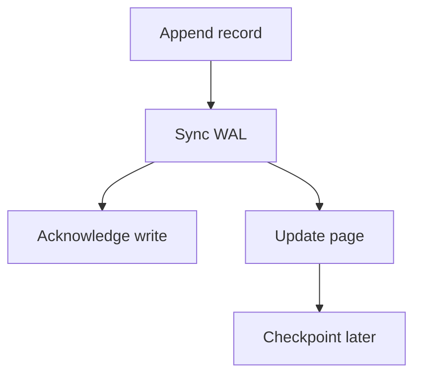

---
{
  "slug": "wal-before-pages",
  "title": "Why the log comes before the page",
  "date": "2026-10-19",
  "tags": [
    "storage",
    "Durable DB"
  ],
  "takeaways": [
    "Sync the log before acknowledging durable writes.",
    "Validate partial log records.",
    "Test recovery separately from throughput."
  ],
  "summary": "# Why the log comes before the page  A small storage-engine thought experiment. This is an illustrative notebook entry, not a benchmark or a claim that Durable DB is complete.  > [!NOTE] > ==Durability is an explicit contract.== T",
  "draft": false
}
---

# Why the log comes before the page

A small storage-engine thought experiment. This is an illustrative notebook entry, not a benchmark or a claim that Durable DB is complete.

> [!NOTE]
> ==Durability is an explicit contract.== This simulation models ordering; it does not emulate a device cache or a real crash.

## The uncomfortable window

A process changes a value in memory. It writes a database page. Before that page is completely persisted, the machine loses power. What should the next process trust?

==A successful write() is not a durability guarantee.== The operating system may still hold the bytes in a cache.

## Record intent first

A write-ahead log records enough information to redo a change. A simple ordering is:

1. Append the log record.
2. Synchronize the log before acknowledging durable success.
3. Apply the change to a database page.
4. Recover by replaying durable records after a crash.



!!The log also needs framing and validation.!! A crash can leave a partial final record. Checksums and record lengths help detect incomplete or corrupt data.

## Try the failure

Append a batch, then crash before syncing. Try again, this time syncing first. Compare what survives.

```sim
<h2>A tiny recovery model</h2>
<button id="append">Append</button><button id="sync">Sync</button><button id="crash">Crash</button>
<pre id="state"></pre>
<script>
let pending=0,durable=0;
function draw(){state.textContent='Unsynced: '+pending+'\nDurable: '+durable}
append.onclick=()=>{pending++;draw()};
sync.onclick=()=>{durable+=pending;pending=0;draw()};
crash.onclick=()=>{console.log('Lost '+pending+' unsynced records');pending=0;draw()};draw();
</script>
```

## A cost worth sharing

If one synchronization takes $T_s$ and we share it across $b$ writes, the synchronization component per write is roughly:

$$T_{write} \approx \frac{T_s}{b}$$

This omits queueing, serialization and device behavior. Larger batches can improve throughput while making some writes wait longer.

```cpp
// Ordering sketch only, not a complete WAL implementation.
append_log(record);
sync_log();
acknowledge_write();
apply_to_page(record);
```

## What to measure next

Measure throughput, tail latency and recovery correctness separately. A fast implementation that loses acknowledged writes has failed its durability contract.

==Crash tests are part of the design, not just a final check.==

