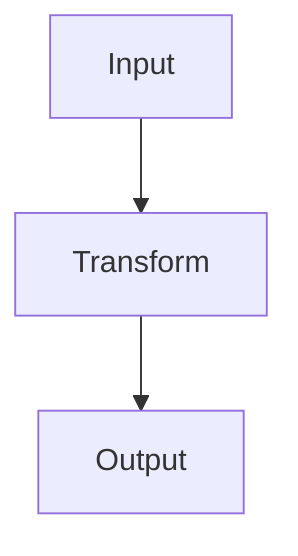

# Ready-to-paste author examples | examples, not a schema migration

## Blog article markdown (existing renderer)

````markdown
# An engineering note

A measurable observation with ==important context== and !!a caution!!.

## Mathematical model

Inline $E = mc^2$ and display:

$$
\sum_{i=1}^{n} x_i
$$

## Code

```python
print("hello")
```

> [!NOTE] This was measured on a local dataset.

> A plain quotation stays a plain blockquote.




```sim
<h2>Demo</h2><button onclick="document.querySelector('h2').textContent='Clicked'">Click</button>
```
````

Only a sandboxed HTML/JS `sim` block runs. `python`, `cpp`, etc. code blocks are display-only.

## JS/HTML live + Python/C++ display-only code tabs (PROPOSED; not in existing renderer)

```json
{
  "version": 1,
  "input": "x = 3",
  "tabs": [
    {"language": "JavaScript", "source": "console.log(3 * 3)", "runnable": true},
    {"language": "Python", "source": "print(3 * 3)", "runnable": false, "capturedOutput": "9"},
    {"language": "C++", "source": "std::cout << 3 * 3 << '\n';", "runnable": false, "capturedOutput": "9"}
  ]
}
```

This example is a future data contract. It is not accepted by `renderPost` today. Captured output must come from locally running the supplied code, never invented.

## Existing data shapes (abbreviated)

```js
// Blog: POSTS item
{ slug: 'example-post', title: 'Example', date: '2026-11-08',
  tags: ['Python'], body: '# Example\n\nBody', takeaways: ['One lesson'],
  project: 'example-project', sample: false }
// Project: P item
{ id: 'example-project', t: 'Example', d: 'Summary', dl: 'Markdown detail',
  st: ['Python'], tg: 'backend', lv: '', g: '', repo: 'https://github.com/example/repo' }
```

Changelog: 2026-11-08 | Examples derived from existing renderer plus clearly labeled proposed code tabs.
